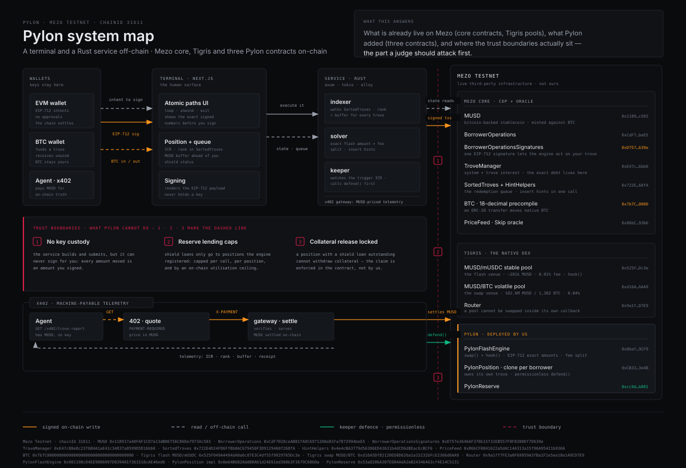
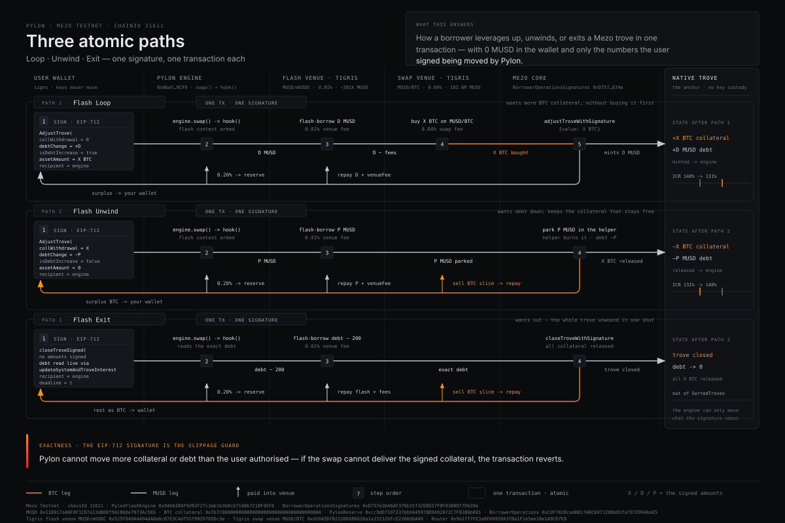

# Pylon

**Non-custodial flash leverage, self-deleveraging and a redemption shield for Bitcoin on Mezo.**

Mezo lets anyone borrow `MUSD` against BTC at a fixed 1% rate. Pylon gives that loan three abilities it
does not have on its own — and it does so **on the user's existing, native Mezo trove**, without moving
the position into a proprietary vault and without asking for a single dollar up front.

| Ability | What it replaces | Live proof (Mezo Testnet) |
| --- | --- | --- |
| **Flash Loop** — borrow against your own trove and atomically convert the borrowed MUSD into more BTC collateral, or into MUSD+MEZO yield | 6–15 manual borrow → swap → re-collateralise transactions | [`0x7933c853…`](https://explorer.test.mezo.org/tx/0x7933c8531f1c368da18ec70496e3d5eb5d6167f2b0160a63db224d21751e6430) |
| **Flash Unwind** — repay debt out of the trove's *own* collateral when you are out of MUSD | "bring MUSD from somewhere else or get liquidated/redeemed" | [`0xe7e02053…`](https://explorer.test.mezo.org/tx/0xe7e020535e7888a5d34a51eedacac0f79d2e84ef100c728e33817fb39b32b7e2) |
| **Flash Exit** — close the trove entirely, funded by its collateral | sell BTC spot, bridge, repay — three venues and a week of patience | [`0xfd3e382f…`](https://explorer.test.mezo.org/tx/0xfd3e382ffa9b180939f52dfd8214f75ef6e1bc9f28bd42de500d572e7de48311) |
| **Redemption Shield** — a MUSD reserve that permissionlessly pushes a shielded position back out of the redemption queue | watching `SortedTroves` by hand and reacting late | [`0x0e3b6710…`](https://explorer.test.mezo.org/tx/0x0e3b671079592808ca499c830367a4f7deb012ae2c0f7bd9b6e9cdda2a2fb511) |

Every row above is a mined Mezo Testnet transaction against live Tigris pools and live Mezo core
contracts. Nothing in this submission is a mock-up of a chain.

---

## 1. Product

### One sentence

Pylon is an execution engine that turns a static Mezo bitcoin loan into an elastic, self-defending
position — atomic leverage, atomic deleveraging, and a paid-for defence against redemptions — while
never taking custody of the user's collateral.

### Who it is for

* **Bitcoin holders borrowing MUSD on Mezo** who want capital efficiency (loop, earn) without hand-running
  a dozen transactions per adjustment.
* **Borrowers who spent their MUSD** and can no longer repay, because on `mezo.org` repayment requires
  MUSD you do not have while your collateral sits locked beside you.
* **Aggressive borrowers near the redemption tail** — the ones a healthy-looking 135% collateral ratio
  does not protect, because in Mezo the *lowest* ratio above 110% is what gets redeemed against.
* **Agents and operators** who need the same three operations as a service (the engine exposes them over
  HTTP, and the paid telemetry endpoint settles in MUSD via x402).

### The problem, precisely

Mezo is a Liquity-style CDP system. Three properties combine into a trap:

1. **Looping is manual.** Borrowing MUSD to buy more BTC requires you to already hold MUSD for the first
   step, then repeat: borrow → swap → add collateral → borrow. Each leg is a transaction, each leg
   moves your collateral ratio, and none of them are atomic.
2. **Repayment needs external MUSD.** If your MUSD is spent, deployed, or simply gone, you cannot use
   your own BTC to repay: `BorrowerOperations.repayMUSD` burns MUSD from the caller while your
   collateral is only withdrawable *after* the repayment. A borrower with $10,000 of equity and a
   falling price has no way to reach it.
3. **Liquidation is not the only risk.** Any MUSD holder can redeem 1 MUSD for $1 of BTC against the
   **lowest-ICR trove above 110% MCR**. A 135% borrower can lose BTC to a redemption and never see a
   liquidation warning. This queue is public on-chain and invisible in every interface.

### The idea

Mezo already contains the parts needed to fix all three, and no product had put them together:

* **`BorrowerOperationsSignatures`** lets a *contract* act on a user's existing trove from a single
  EIP-712 signature. The user keeps their trove, their collateral and their keys; the engine gets
  authorisation for exactly one adjustment, with the exact collateral and debt deltas signed.
* **Tigris pools** are Solidly-style and expose `IPoolCallee.hook`, i.e. optimistic flash liquidity, in
  the same DEX the user already trades on.
* **BTC is an 18-decimal ERC-20/native precompile**, so BTC received from a swap can be forwarded as
  `msg.value` into the next trove adjustment inside the same transaction.

Combine them and a Mezo trove becomes programmable: borrow, swap, re-collateralise and repay in one
atomic block, with the user's signature as the only authority.

### Why now

* MEZO went live in Q1 2026; the Earn flywheel (veBTC/veMEZO), the native DEX and cross-chain MUSD are
  all in production — there is real liquidity to flash against.
* MUSD in circulation roughly doubled through H1 2026, and 826 BTC of collateral sits behind it. The
  redemption and liquidation surface grows with the book.
* Mezo's own 2026 roadmap lists "AI-ready infrastructure" and agent payments; the same primitives that
  make Pylon possible for humans make it callable by software.

### What already existed, and why it is not enough

| Approach | Where it stops |
| --- | --- |
| Doing it by hand on `mezo.org` | Not atomic. One leg failing leaves you half-levered with a live liquidation price you did not choose. |
| A per-user clone vault (the shape of earlier Mezo hackathon winners) | The user's position *moves into the vault*. Their native trove is abandoned, existing loans cannot be operated on, and the vault's collateral is no longer the thing `mezo.org` shows them. |
| Bots that call `repayMUSD` | They need MUSD. The whole failure mode is not having MUSD. |
| Dashboards that display ICR | They show the liquidation line, not the redemption queue. A dashboard cannot defend anything. |
| Generic flash-loan tooling | Mezo's flash venue and its swap venue cannot be the same pool (see §5.1). Getting this wrong produces a transaction that silently under-reports its input. |

---

## 2. User experience

### Primary workflow

1. **Look at the radar.** The terminal opens on the live `SortedTroves` queue: every one of the 245
   troves, ordered by nominal collateral ratio, with the MUSD that must be redeemed before the queue
   reaches each one. The vertical axis is *survivable BTC drawdown* (`1 − MCR/ICR`) rather than ICR,
   because that is the quantity a borrower actually manages: 111% and 128% are a rounding error apart on
   a linear ICR axis and a cliff apart in a drawdown.
2. **Pick a mode.** `Loop`, `Unwind`, `Exit`, `Shield`. The architect shows the full atomic path for
   the chosen size — flash venue, swap venue, venue rate vs oracle rate, both fees, post-operation
   collateral, debt, ICR, liquidation price and the trove's new queue rank — *before* anything is
   signed.
3. **Sign once.** For a native trove, one EIP-712 `AdjustTrove` (or `CloseTrove`) authorisation. For a
   Pylon position, one transaction, no signature dance. Both broadcast from the user's wallet or
   through the engine service, which is what lets a hardware or Bitcoin-wallet user participate.
4. **Watch it land.** Every operation writes a proof row linking to the explorer transaction and the
   exact event emitted (`Looped`, `Unwound`, `Exited`, `Defended`).

### Activation moment

The moment the terminal shows your own trove's rank in the redemption queue and the MUSD buffer ahead
of it — for most Mezo borrowers, the first time they learn that a 160% collateral ratio can still lose
BTC. The second activation is pressing *Flash Unwind* with `0 MUSD` in the wallet and seeing the debt
fall.

### Retention loop

*The shield* is the habit: set a band (`defend below X% ICR, toward Y%`), and the reserve defends the
position whenever it enters it — permissionlessly, by anyone, including a keeper that runs 24/7 while
the owner sleeps. The reserve is paid by flash origination fees, so it is also the only Mezo product
where lending MUSD to defend someone is a yield strategy with an enforceable claim.

### Differentiation in the interface

* **A queue, not a number.** Rank and MUSD-buffer-ahead are first-class readouts, not a footnote.
* **Atomicity is visible.** The X-Ray lists each leg with its venue and rate; the user can see that the
  whole thing reverts together.
* **Provenance is labelled.** Every panel states whether its numbers come from the engine service, from
  a direct chain read, or from the frozen deployment ledger.
* **No invented data.** Empty states are empty; unavailable values render as `—`, never as a
  plausible-looking number.

---

## 3. Innovation

**What becomes possible that was not:**

1. **Leverage without pre-existing MUSD.** A borrower can take a 0.045 BTC trove and turn it into 0.05
   BTC of collateral in one transaction, because the flash leg supplies the MUSD that the loop spends
   before the trove borrow arrives.
2. **Exit liquidity out of your own collateral.** `Flash Unwind` and `Flash Exit` let a borrower
   deleverage or close *from inside the position*, at any time, with an empty MUSD balance. This is the
   primitive that did not exist: on `mezo.org` those paths require external MUSD.
3. **A priced market for redemption defence.** Redemptions are deterministic, not random: they walk up
   from the lowest-ICR trove. Pylon turns that fact into a product — reserve capital that is lent only
   to repay debt, only for registered positions, capped three ways, and secured by a claim the position
   cannot route around (withdrawing collateral while a shield loan is outstanding reverts, verified
   on-chain).
4. **Machine-callable credit operations.** The same quote/execute surface is exposed to agents, and the
   paid telemetry endpoint settles in MUSD over `x402` on the same chain.

**Why it is not a thin wrapper**

* The engine implements flash-loan accounting itself: it computes the exact venue fee required for the
  pool's invariant to hold, keeps every leg delta-based (`balance − snapshot`), returns dust to the
  beneficiary, and refuses to leave value stranded.
* It implements the EIP-712 ballot construction for Mezo's signature helper and mirrors the on-chain
  solver in Rust, so quotes and execution agree by construction (both call the same preview functions
  on the deployed engine).
* The reserve is a real credit facility with utilisation caps and an on-chain claim, not a fee sink.
* Eleven integration bugs that only appear against live Mezo infrastructure were found and fixed during
  the build — they are documented in §5 because the reasoning is the credibility of the thing.

---

## 4. Hackathon relevance

* **Event:** AKINDO × Mezo — *Build with MUSD and MEZO: Bitcoin's Economic Layer*.
* **Track:** **Track 1 — DeFi (Borrowing, Lending, Looping, Yield)**, primary; the terminal, the shield
  reserve and the x402 endpoint also serve **Track 2 — Access and Distribution**.
* **Sponsor technology integrated (both assets, nine live contracts):** `MUSD`, `MEZO`-era Mezo core
  (`BorrowerOperations`, `BorrowerOperationsSignatures`, `TroveManager`, `SortedTroves`, `HintHelpers`,
  `PriceFeed`, BTC precompile), Tigris (`MUSD/mUSDC` flash venue, `MUSD/BTC` swap venue, `Router`,
  `PoolFactory`), and Mezo's `x402` payment path (facilitator-compatible, plus a fully trustless
  on-chain settlement path).
* **Judging criteria mapping**

  | Criterion (weight) | Evidence in this submission |
  | --- | --- |
  | **Mezo Integration (30%)** | Nine live Mezo/Tigris contracts orchestrated per transaction; both MUSD and BTC legs; `SortedTroves` indexed in full (245 troves) every refresh; signatures verified by Mezo's own helper; MUSD borrowed and repaid, never wrapped. |
  | **Product & Business Viability (30%)** | Three operations the Mezo app cannot do, aimed at its existing borrower base; a shield pool with real fee revenue (5.18 MUSD earned from 1,000 MUSD seeded) and an enforceable claim; distribution inside the terminal that borrowers already need. |
  | **Technical Implementation (20%)** | 19 Foundry tests over a faithful Mezo/Tigris mock harness, 6 Rust tests whose vectors are cross-checked against `cast`, real deployments, and the §5 engineering log. |
  | **User Experience (10%)** | Redemption radar and atomic path X-Ray; semantic colour; monospace ledger density; loading/empty/error states in every panel; reduced-motion support. |
  | **Submission Materials (10%)** | This README, three purpose-built diagrams, the live proof ledger, and explorer links for every claim. |

---

## 5. Architecture

### System overview



* **`contracts/` — Solidity 0.8.24 + Foundry.** `PylonFlashEngine` (atomic entrypoints, flash
  accounting, fee routing, post-op guards), `PylonReserve` (shield pool: shares, caps, defence loans),
  `PylonPosition` (EIP-1167 clone per user that owns its own trove and enforces its own shield policy).
* **`server/` — Rust (Axum + Tokio).** Indexes `SortedTroves` in full (batched JSON-RPC), solves flash
  routes and hints, builds and sends signed transactions, runs the keeper, serves the HTTP API, settles
  the `x402` endpoint, and keeps the append-only proof ledger.
* **`web/` — Next.js 15 + TypeScript + wagmi/viem.** Static export; works against the engine API or
  directly against Mezo RPC (`READ-ONLY` mode) with no backend at all.

### The three atomic paths



**Loop** (signature path): the user signs `AdjustTrove(collWithdrawal = 0, debtChange = D,
isDebtIncrease = true, assetAmount = X, borrower, recipient = engine)`. The engine flashes `D` MUSD
from the MUSD/mUSDC pool, swaps `D − fees` for BTC on the MUSD/BTC pool, calls
`BorrowerOperationsSignatures.adjustTroveWithSignature{value: X}`, which adds `X` BTC of collateral and
mints `D` MUSD to the engine, repays the flash (`D + venue fee`), routes the Pylon fee to the reserve and
returns any surplus BTC to the user.

**Unwind**: the user signs `AdjustTrove(collWithdrawal = X, debtChange = P, isDebtIncrease = false,
assetAmount = 0)`. The engine flashes exactly `P`, hands it to the signature helper (which burns it from
the engine), the trove's debt falls by `P` and `X` BTC is released to the engine, which sells just enough
BTC to cover `P + fees` and returns the remainder — BTC and MUSD — to the owner.

**Exit**: the engine reads the exact debt (after `updateSystemAndTroveInterest`, inside the same block, so
the flash is exact), flashes `debt − 200 MUSD` (the gas deposit is not repayable), closes the trove with
`closeTroveWithSignature`, sells a slice of the released collateral to repay the flash, and returns the
rest as BTC.

### Data flow of one quote

```
terminal ──GET /api/v1/quote/loop?collAdd=…──► Rust solver
                                              ├─ engine.previewLoopDebtForCollateral()   (deployed contract)
                                              ├─ engine.flashPoolFeeBps() / swapPoolFeeBps()
                                              ├─ engine.previewBtcOut()
                                              ├─ borrowerOps.getBorrowingFee()
                                              └─ radar cache (SortedTroves, full index)
terminal ◄── debtDelta, fees, post-ICR, rank, legs, venue-vs-oracle rate ──┘
```

The quote is computed by the *deployed* engine's own preview functions, so the numbers the interface
shows are by construction the numbers the contracts enforce.

### Constraints that shaped the design (found by executing against live Mezo)

1. **A Solidly pool cannot be swapped inside its own flash callback.** `Pool.swap` recomputes its
   reserves *after* the hook returns, so a nested swap sees an understated balance and reports zero (or
   negative) input. Pylon therefore flashes from a MUSD pool (`MUSD/mUSDC`, 0.01%) and swaps on the
   MUSD/BTC pool (0.04%). Any design that returns to the same pool inside the callback is broken in a
   way that only shows up on-chain.
2. **`BorrowerOperationsSignatures` burns repayment MUSD from *its own caller*.** Not from itself. Engine
   v1 parked the flash proceeds at the helper and the live transaction reverted with
   `BorrowerOps: Caller doesnt have enough mUSD to make repayment`
   ([evidence](https://explorer.test.mezo.org/tx/0x431f0f1914756284dbef77327908b9e5d9d50da79e01ee562147c4ba320f9349)).
   v2 keeps the MUSD in the engine and asserts the balance up front.
3. **A starved inner frame looks like a maths bug.** The EVM forwards `63/64` of the remaining gas per
   hop; a Pylon loop nests engine → pool → hook → router → pool → trove. Mezo's gas estimator fails
   outright on this path, so an inner frame ran out and surfaced as a bare arithmetic panic. The fix is
   a large explicit floor (`GAS_LIMIT`, default 6M against Mezo's 10M block limit); unused gas is
   refunded. The engine now reports which leg failed (`StageFailed(stage, gasLeft, reason)`) instead of
   a bare panic — added in v3 and kept.
4. **On-chain hint resolution is expensive.** `HintHelpers.getApproxHint(nicr, 40, seed)` measured at
   ~4.75M gas on a 245-trove book. v4 passes solver-computed hints into positions, which validate them
   in-contract and only fall back (12 trials) when a hint is stale.
5. **The minimum-debt floor bounds the shield.** Mezo requires 1,800 MUSD of net debt. A shield target
   ICR is only reachable if `collateral × price / target ≥ 2,000`. The live position hit exactly this:
   a 0.045 BTC trove at the minimum debt is already at its maximum achievable ICR, so a defence can only
   move a position whose debt is above the floor. The interface computes the reachable ceiling and names
   it, instead of proposing a repayment the protocol will reject.
6. **Fees are always in MUSD.** A loop's origination fee is taken from the borrowed amount before the
   swap; an unwind's and an exit's fee comes out of the swap proceeds. No leg ever requires the user to
   hold MUSD, and the fee formula includes the venue's own required over-repayment
   (`fee ≥ amount × f / (10000 − f)`) so the pool's invariant check passes exactly.
7. **The BTC precompile unifies the ledgers.** Verified live: `eth_getBalance(engine)` equals
   `IERC20(BTC).balanceOf(engine)`. That equality is the reason a swap output can pay gas, collateral and
   a `msg.value` leg in the same transaction.

### External dependencies

| Dependency | Why | Failure behaviour |
| --- | --- | --- |
| Mezo Testnet RPC | Chain state and transaction submission | The service retries with backoff; the terminal falls back to direct RPC reads and labels itself `READ-ONLY` |
| Mezo core contracts | Borrowing, collateral, sorted list, oracle | No fallback: a quote without them is meaningless and is not fabricated |
| Tigris pools + router | Flash liquidity and BTC pricing | Size ceilings are computed from live reserves; a thin venue shrinks the maximum, it never silently degrades the swap |
| `x402` facilitator (optional) | Signature-based settlement for agents | The endpoint also settles with a plain on-chain MUSD transfer verified by the service itself, so the facilitator is never required for correctness |

---

## 6. Running

### Prerequisites

* Rust 1.75+ (nightly is fine), `cargo`
* Node 20+ and `pnpm`
* [Foundry](https://book.getfoundry.sh/) (`forge`, `cast`)
* A Mezo Testnet account with testnet BTC for gas (faucet: <https://faucet.test.mezo.org>)

### Contracts

```bash
cd contracts
forge install foundry-rs/forge-std OpenZeppelin/openzeppelin-contracts --no-commit
forge build
forge test -vvv                    # 19 tests: atomic paths, guards, reserve accounting, math
forge script script/Deploy.s.sol:Deploy \
  --rpc-url https://rpc.test.mezo.org --private-key $PRIVATE_KEY --broadcast
```

`script/Prove.s.sol` is a read/verify helper for the live deployment (it prints wiring, previews and the
radar). Note that Mezo's BTC-balance and oracle precompiles cannot execute inside a forked EVM, so
state-changing flows are exercised through the Rust engine rather than through a forked test.

### Engine service

```bash
cd server
cp ../contracts/deployments/31611.json .   # deployment record (addresses per chain)
cat > .env <<'EOF'
PRIVATE_KEY=0x…            # operator key (keeper + proof runner); never required for the API alone
CHAIN_ID=31611
RPC_URL=https://rpc.test.mezo.org
DEPLOYMENT=./31611.json
X402_PAY_TO=0x…            # MUSD recipient for the paid telemetry endpoint
EOF
cargo build --release
./target/release/pylon-server status          # market + reserve + wiring
./target/release/pylon-server radar --limit 10 # the live redemption queue
./target/release/pylon-server loop-quote --coll-add 0.005 --owner 0x…
./target/release/pylon-server serve           # API + keeper + radar refresher on :8787
./target/release/pylon-server prove --phase 3 # execute one live proof phase (3 = flash loop)
./target/release/pylon-server prove --phase 3 --simulate   # dry-run the same call
cargo test                                    # ABI + EIP-712 vectors cross-checked against cast
```

### Terminal

```bash
cd web
pnpm install
pnpm dev                     # http://localhost:3000
pnpm build                   # static export to ./out
NEXT_PUBLIC_API_BASE=http://localhost:8787 pnpm build   # point the bundle at the engine service
```

With no engine service running the terminal still works: it reads Mezo Testnet directly and shows
`RPC READ-ONLY` in the header.

### Environment variables

| Variable | Default | Purpose |
| --- | --- | --- |
| `RPC_URL` | per-chain default | Mezo JSON-RPC endpoint |
| `DEPLOYMENT` | `../contracts/deployments/<chainId>.json` | Address book |
| `PRIVATE_KEY` | — | Operator key for the keeper and proof phases only |
| `PORT` | `8787` | API port |
| `DATA_DIR` | `./data` | Append-only proof ledger |
| `KEEPER_INTERVAL_SECS` | `45` | Radar/keeper cadence |
| `AUTO_DEFEND` | `0` | `1` lets the keeper broadcast defences (defence is permissionless; this key is one caller) |
| `GAS_LIMIT` | `6_000_000` | Explicit floor for nested flash transactions |
| `X402_PAY_TO`, `X402_FACILITATOR`, `X402_PRICE` | — / `facilitator.vativ.io` / `$0.001` | Paid telemetry endpoint |
| `POSITIONS` | — | Comma-separated position addresses for the keeper and the reserve panel |
| `NEXT_PUBLIC_API_BASE` | `http://localhost:8787` | Engine service URL for the terminal |

---

## 7. Demo

### Deployed application

* **Terminal:** static export (`cd web && pnpm build` → `web/out`), deployable to any static host.
  Run it locally with `pnpm dev` (or `pnpm exec serve out` for the production bundle).
* **Engine service:** `pylon-server serve` (Rust binary). Any host with outbound RPC works.
* **Network:** Mezo Testnet, chain ID `31611`, explorer <https://explorer.test.mezo.org>.

### What a judge should try first

1. **Open the terminal without connecting anything.** The redemption radar loads live: 245 troves,
   ~429M MUSD of queue depth ahead of the tail, the nearest trove at 111.4% ICR, and the MUSD buffer
   needed before the queue reaches each one. Click any row to inspect that trove.
2. **Read the tail table.** Notice that ranks 1–9 sit between 111% and 128%: those are the troves
   redemptions will touch next, at collateral ratios no liquidation alarm would flag.
3. **Open `Reserve`.** 1,005.18 MUSD of assets, share price 1.00518 (the pool has already earned 5.18
   MUSD of flash fees), 543.94 MUSD lent to a single live position at 179.9% ICR with its shield
   `armed`, and the loan's claim enforced in code.
4. **Open `Proofs`.** Every operation the product claims, with its transaction hash, the event to look
   for, and a "how to verify a row" panel.
5. **Connect a wallet with a trove** (or paste a trove address into the architect) and drag the loop
   slider: the X-Ray shows the exact atomic path, both fees, the venue rate versus the oracle, and the
   post-operation ICR before anything is signed.

### Demo flow for a recording (≈2 minutes)

1. Radar: "`SortedTroves`, all 245 troves, ranked by who gets redeemed against first. This borrower sits
   at 111% and there is nothing between them and a redemption."
2. Architect → `Loop`: 0.005 BTC, one signature → show the live transaction
   [`0x7933c853…`](https://explorer.test.mezo.org/tx/0x7933c8531f1c368da18ec70496e3d5eb5d6167f2b0160a63db224d21751e6430)
   landing: collateral and debt both moved, the flash was repaid inside the same transaction, and the
   reserve's share price ticked up.
3. Architect → `Unwind`, with **0 MUSD in the wallet** → show
   [`0xe7e02053…`](https://explorer.test.mezo.org/tx/0xe7e020535e7888a5d34a51eedacac0f79d2e84ef100c728e33817fb39b32b7e2):
   300 MUSD of debt repaid from the trove's own collateral.
4. Architect → `Exit` → show
   [`0xfd3e382f…`](https://explorer.test.mezo.org/tx/0xfd3e382ffa9b180939f52dfd8214f75ef6e1bc9f28bd42de500d572e7de48311):
   trove closed, net BTC back in the wallet, no MUSD required at any point.
5. Shield: show position `0xE077…DC23` before and after the permissionless defence
   [`0x0e3b6710…`](https://explorer.test.mezo.org/tx/0x0e3b671079592808ca499c830367a4f7deb012ae2c0f7bd9b6e9cdda2a2fb511)
   — 142% → 180% ICR, 543.94 MUSD lent by the reserve, and a withdrawal attempt reverting with
   `ReserveDebtOutstanding` until the loan is settled.

### Second track: machine access (`x402`, MUSD)

```bash
curl -i http://localhost:8787/api/v1/x402/trove-report/0xe0773065977747d34e94397fc902178709ccdc23
# HTTP/1.1 402 Payment Required + PAYMENT-REQUIRED: <base64 payment requirements>
# settle 0.001 MUSD to the pay-to address, then retry with:
#   X-PAYMENT-TX: <tx hash>        (verified on-chain by the service itself)
# or attach a signed x402 payload as PAYMENT-SIGNATURE (facilitator-verified)
```

---

## 8. Verification

### Deployed on Mezo Testnet (chain 31611)

| Contract | Address |
| --- | --- |
| `PylonFlashEngine` | [`0x94b6384F9202F27c3ab1b3b0c6f1A8b7218F45F6`](https://explorer.test.mezo.org/address/0x94b6384F9202F27c3ab1b3b0c6f1A8b7218F45F6) |
| `PylonReserve` | [`0xcc9dD7197237bbb645978D9A92872C7F82B6b881`](https://explorer.test.mezo.org/address/0xcc9dD7197237bbb645978D9A92872C7F82B6b881) |
| `PylonPosition` (template) | [`0x504DcDD85FD82C2974F27b1f71B6cc116EbE18bE`](https://explorer.test.mezo.org/address/0x504DcDD85FD82C2974F27b1f71B6cc116EbE18bE) |
| Live shielded position | [`0xe0773065977747d34e94397fc902178709ccdc23`](https://explorer.test.mezo.org/address/0xe0773065977747d34e94397fc902178709ccdc23) |

### Real vs simulated — stated plainly

| Surface | Status |
| --- | --- |
| Flash Loop, Flash Unwind, Flash Exit on a native Mezo trove | **Real, live, mined.** Three transactions above, against live pools. |
| EIP-712 authorisation | **Real.** Verified by Mezo's deployed `BorrowerOperationsSignatures`; the engine's digest construction is unit-tested against an independent `cast`-derived vector. |
| Shield reserve (shares, caps, fee revenue) | **Real.** 1,000 MUSD seeded; 5.18 MUSD of flash fees received; 543.94 MUSD lent to one position. |
| Shield defence | **Real.** Permissionless call by a third party; ICR 142% → 180%; verified on-chain. |
| Claim enforcement (`ReserveDebtOutstanding`) | **Real.** A collateral withdrawal from the owner while the loan is outstanding reverts. |
| Redemption radar and quotes | **Real chain reads.** Full `SortedTroves` index, batched JSON-RPC; previews executed on the deployed engine. |
| Position flash loop (engine → position → Mezo) | **Implemented and unit-tested; not yet executed on-chain for the live position.** The live position predates engine v4 and pays for on-chain hint resolution (~4.75M gas), which the 10M block limit makes unreliable; v4 passes solver hints and exists for new positions. The same code path without the flash leg (`PylonPosition.addCollateral`) has executed live: debt 2,001.8 → 2,602.4 MUSD. |
| `x402` endpoint | **Real 402 challenge + on-chain settlement verification.** The MUSD transfer is verified by the service against a mined receipt and transfer log; the facilitator path is implemented but optional. |
| Native BTC-wallet trove opening through the UI | **Not implemented.** Opening a trove is available on `mezo.org`; Pylon operates on troves that exist. |

### What is *not* built

No mainnet deployment, no audit, no token, no chain of our own, no mobile app, no custody, no
"AI agent" that trades on your behalf. The keeper defends only positions whose owners armed a policy,
and only upward.

---

## 9. Security and reliability

### Trust model

* **Non-custodial by construction.** Pylon never holds a user's collateral or keys. Native-trove
  operations need a fresh EIP-712 authorisation per action; position operations are callable only by
  the position's owner or a nominated executor (`canExecute`), and the position can only mutate its own
  trove.
* **The signature is the slippage guard.** The user signs exact collateral and debt deltas. If the pool
  cannot deliver the signed collateral, the transaction reverts; nothing "splits the difference". The
  engine can never exceed the authorised movement.
* **Flash callback authentication.** `hook` requires `msg.sender == flashPool`, an active self-initiated
  flash (`_op != NONE`) and `sender == address(this)`. A third party cannot invoke the callback, and the
  engine cannot be tricked into treating an arbitrary call as a flash.
* **Deterministic token flow per leg.** Every balance movement is computed as a delta from a snapshot
  taken at the start of the flash, and residue is swept to the beneficiary rather than left in the
  engine. Unit tests assert the engine holds no idle MUSD after a loop, an unwind and an exit.
* **Reserve as a lender with hard limits.** Only registered positions may borrow; per-call,
  per-position and utilisation caps are enforced on-chain; the reserve can only ever reduce a
  position's debt; and the position's claim blocks collateral release and exit until it is settled. The
  reserve is explicitly *not* a savings product with a guaranteed return, and the interface says so.
* **Optional post-operation ICR floors.** Callers can require a minimum post-trade collateral ratio,
  which the engine checks before returning.

### Failure handling

| Failure | Behaviour |
| --- | --- |
| Swap cannot deliver the signed collateral | Whole transaction reverts; no partial state |
| Flash cannot be repaid (quote moved) | Reverts inside the pool's invariant check |
| Stale solver hints | `SortedTroves` walks to the valid position; hints cost gas, never correctness |
| RPC outage | Engine retries with backoff; the terminal degrades to `RPC READ-ONLY` or the frozen ledger with a label |
| Treasury/owner key lost | Users' operations continue (they are user-signed). Only fee routing and reserve governance stall |
| Reserve exhausted (utilisation cap) | Defence pauses; the position stays visible with its ICR and remaining buffer |

### Known risks

* **Oracle vs venue price.** The MUSD/BTC pool has traded ~4% *below* the Mezo oracle during this build.
  A loop buys BTC at the venue rate (favourable) while an unwind or exit sells into it (the dominant
  cost). The interface prints both rates next to every swap leg and warns at ≥1.5% deviation — a user
  should not discover this from their own P&L.
* **Shield loans are credit risk.** A defence funded today can be followed by a deeper drawdown that
  leaves the loan unsettled and the pool's shares worth less than deposited. Caps bound the damage; they
  do not eliminate it.
* **No rescue function.** The engine has no owner-callable sweep for tokens accidentally sent to it.
  Deliberate (less authority in the contract), documented as a limitation.
* **Single operator key.** The keeper and the proof runner share one key. It can only do what anyone can
  do (defend a position in its own configured band), but it should become a dedicated hot key with a
  policy contract before mainnet.

---

## 10. Limitations and roadmap

**Limitations**

* Native-trove operations require a signing wallet; only positions support delegated, autonomous
  defence. Closing that gap is the first roadmap item.
* The shield protects positions, not arbitrary troves, because autonomous defence requires owning the
  trove key — the same reason every Mezo keeper design that promises "protect your existing loan without
  moving it" is either custodial or signature-gated.
* Flash liquidity is bounded by the MUSD/mUSDC pool (~201k MUSD on testnet). The interface computes and
  names the ceiling rather than failing opaquely.
* Mainnet is not deployed: the flash venue address is chain-specific and must be chosen per network
  (`Deploy.s.sol` takes it from env for that reason).

**Roadmap**

1. **Passkit-style defence for native troves** — pre-authorised, amount-capped, revocable defence
   ballots so a native Mezo trove can be defended while its owner is offline, with the shield's claim
   still enforceable.
2. **Multi-leg yield routing** — deploy loop proceeds into MUSD/BTC and MUSD/MEZO liquidity with the
   shield checking the position's ICR, not just the LP's token count.
3. **Cross-chain reach** — MUSD is an NTT token; a Base or Ethereum-side loop against the same engine
   lets a borrower manage one position from wherever their wallet lives.
4. **Keeper market** — the defence path is already permissionless; adding a bounty makes defence
   competitive instead of dependent on one operator.
5. **Mainnet** with a dedicated operator key, a timelocked reserve governance policy, and an audit of
   the flash accounting.

---

## 11. Repository layout

```
contracts/          Solidity + Foundry (engine, reserve, position, tests, deploy + prove scripts)
  deployments/      Address book per chain, including the lineage of superseded engines
server/             Rust engine service (radar, solver, keeper, x402, proof ledger, CLI)
web/                Next.js terminal (static export, wagmi/viem, RPC fallback)
docs/diagrams/      Three architecture diagrams (SVG) + regeneration notes
AGENTS.md           Engineering and quality standards used for this build
FOUNDER.md          Product philosophy used for this build
```

## 12. License

MIT. Reused code is credited in-file; Tigris pools and Mezo core contracts are consumed as external
dependencies and are not modified or vendored.
